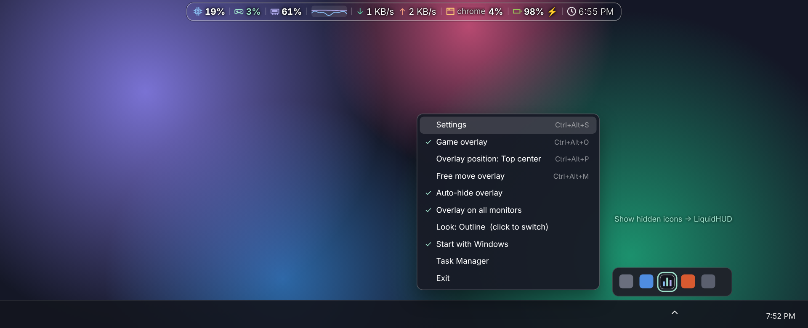
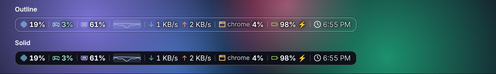
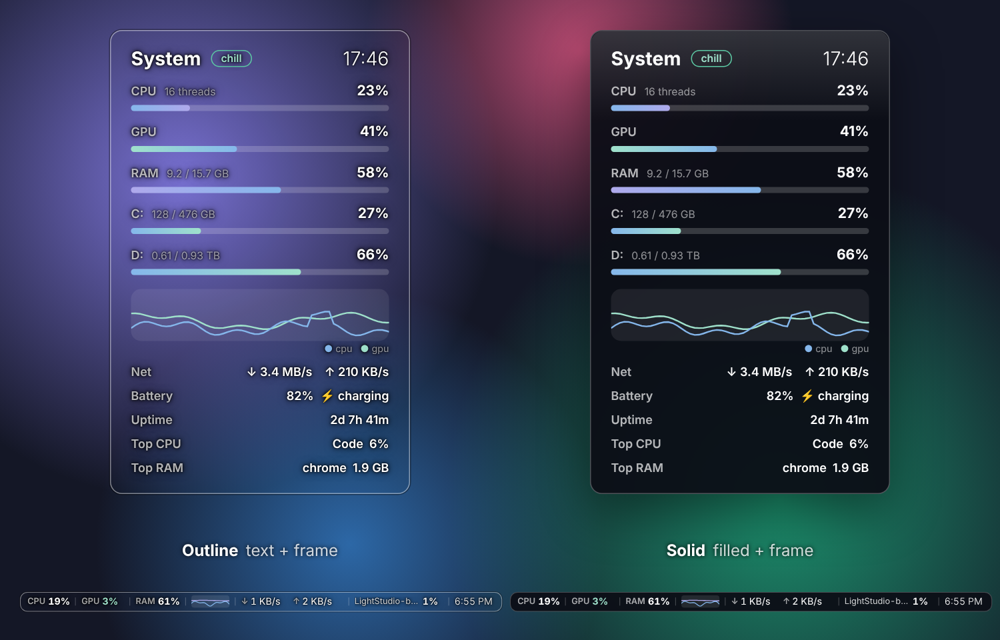
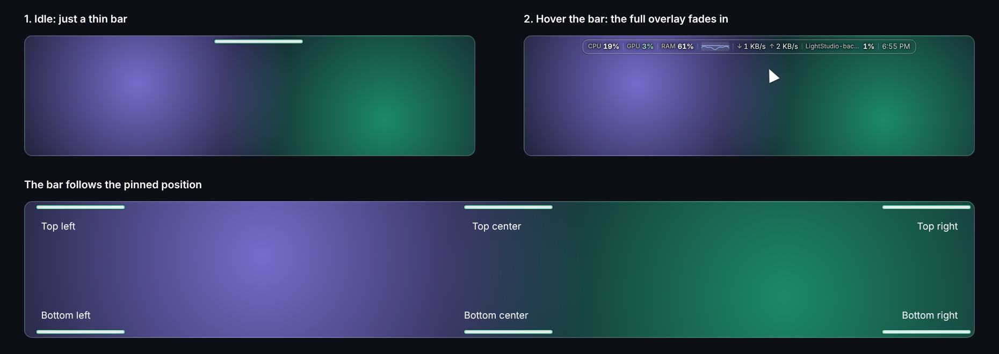
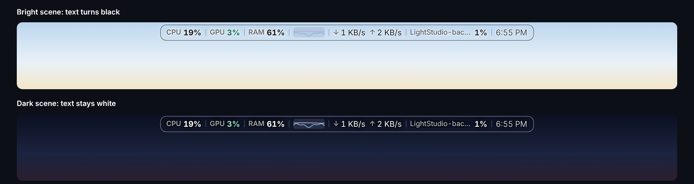
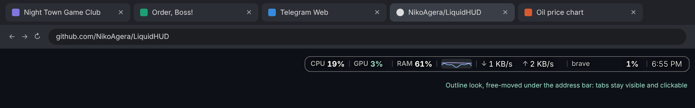

# LiquidHUD

**A tiny game-overlay system monitor for Windows, built with nothing but PowerShell and WPF.**
No installer, no Rainmeter, no HWiNFO, no admin rights. One `.ps1` file that lives in your system tray.



> Images in this README are rendered previews of the UI.

---

## What it does

- **A thin bar on top of everything:** games, browsers, the desktop. It's click-through, so it never blocks anything
- **Live stats:**
  - CPU and GPU %
  - RAM %
  - a mini CPU + RAM graph
  - network down/up
  - the top CPU app and the top RAM app
  - battery
  - a clock (12h or 24h)
- **Coloured icons** for every stat (or plain text labels, if you prefer)
- **Lives in the system tray.** Open *Show hidden icons* on the taskbar, **click** the LiquidHUD icon for Settings, and **right-click** it for the menu
- **Auto-hide:** shrinks to an iPhone-style thin bar. When you hover it, the overlay **pours out of the bar like the macOS genie effect**, and when you move away it pours back in
- **Game mode:** stays fully open over fullscreen and borderless games
- **Adaptive text:** black text on bright scenes, white on dark ones
- **Lightweight:**
  - BelowNormal priority and software rendering
  - metrics you don't tick aren't collected at all

All numbers are read live from Windows, from the same sources Task Manager uses:
- performance counters for CPU and GPU
- memory status, network adapters and the power status
- the process list for the top apps

---

## Install

1. **Download:** click the green **Code** button, then **Download ZIP**. Or use git:
   ```powershell
   git clone https://github.com/NikoAgera/LiquidHUD.git
   ```
2. **Unzip** it to a permanent folder, for example `Documents\LiquidHUD`.
3. **Unblock** it (one time only). Open PowerShell in that folder and run:
   ```powershell
   Get-ChildItem -Recurse | Unblock-File
   ```
4. **Run:** double-click **`Start-LiquidHUD.bat`**. The overlay appears and an icon is added to the tray. The first time, a notification shows you where the icon is.
5. **Start with Windows** (optional): right-click the tray icon and choose **Start with Windows**.

<details>
<summary>Run it manually</summary>

```powershell
powershell -NoProfile -STA -ExecutionPolicy Bypass -File .\LiquidHUD.ps1
```
</details>

---

## Tray icon

| Action | What happens |
|---|---|
| **Click** the icon | Opens Settings |
| **Right-click** the icon | Opens the menu (overlay on/off, position, free move, auto-hide, look, start with Windows, exit) |
| **Hover** the icon | Shows live CPU and RAM in the tooltip |

> In Windows 11, new tray icons go under **Show hidden icons** (the `^` on the taskbar). To keep LiquidHUD always visible, drag its icon onto the taskbar.

---

## Settings


| Setting | What it does |
|---|---|
| **Show the overlay** | Turns the overlay on or off (`Ctrl+Alt+O`) |
| **Start with Windows** | Adds or removes a shortcut in your Startup folder |
| **Coloured icons** | On by default. Each stat has its own small coloured icon. Off shows the text labels (`CPU`, `GPU`, `RAM`) instead |
| **Look** | **Outline** is text and a thin frame, so you see straight through it. **Solid** is a filled dark bar |
| **Overlay position** | Top left, Top center, Top right, Bottom left, Bottom center, Bottom right, or Custom |
| **Free move** | Drag the overlay anywhere. Untick it to lock it in place, and it goes back to click-through. It always stays on screen |
| **Auto-hide** | Shrinks to a thin bar when idle and expands on hover. Not used in Free move or Custom |
| **Genie open / close animation** | On by default. A macOS-style genie: the overlay pours out of the thin bar like a funnel (0.48 s) and back in (0.38 s). It follows the pinned position. If the mouse comes back mid-close, it reverses smoothly. Untick it for instant |
| **Game mode** | Keeps the overlay open while a fullscreen or borderless app is in front |
| **Adaptive text** | In the Outline look, black text on bright backgrounds and white on dark ones |
| **Clock** | 24h (`18:46`) or 12h (`6:46 PM`) |
| **Overlay shows** | Tick what you want: CPU, GPU, RAM, Mini graph, Network, Top CPU app, Top RAM app, Battery, Clock |
| **Refresh rate** | 1 s, 2 s or 5 s. Slower uses less CPU |
| **LiquidHUD itself is using** | Live RAM and CPU used by LiquidHUD |

Settings are saved to `%APPDATA%\LiquidHUD\settings.json`.

### Icons



| Icon | Stat | Colour |
|---|---|---|
| chip | CPU | blue |
| gamepad | GPU | teal |
| memory stick | RAM / top RAM app | purple |
| ↓ / ↑ | download / upload | green / coral |
| app window | top CPU app | amber |
| battery | battery | green |
| clock | clock | white |

The icons are vector paths drawn in code, so they don't depend on any font and stay sharp at any display scaling. With **Adaptive text**, they switch to darker shades on bright backgrounds.

### Looks



### Auto-hide




LiquidHUD checks the cursor position every 80 ms, and only while auto-hide is on. The overlay **stays click-through**, so hovering it never blocks the window underneath.

### Adaptive text



Every 2 s, LiquidHUD samples an 8 px strip right next to the bar. Above 62 % brightness it switches to black text, and below 45 % it switches back to white. The gap between the thresholds stops it from flickering.

### Out of the way



---

## Hotkeys

| Keys | Action |
|---|---|
| `Ctrl+Alt+S` | Open Settings |
| `Ctrl+Alt+O` | Overlay on/off |
| `Ctrl+Alt+P` | Cycle overlay position |
| `Ctrl+Alt+M` | Free move on/off (drag it, then press again to lock) |

---

## Games

- Set the game's display mode to **Borderless** or **Windowed Fullscreen**. In **Exclusive Fullscreen**, the game takes over the whole display and no overlay can draw on top. That's a Windows limit.
- **Anti-cheat:** LiquidHUD is a plain top-most window. It doesn't inject into, hook or read from any game process.
- **Game mode** keeps the overlay open over fullscreen and borderless apps, because games usually lock the cursor, so you couldn't hover the auto-hide bar anyway.

---

## How it works

```
+------------------------------+   synchronized    +----------------------------+
|  Background runspace         |     hashtable     |  UI thread (WPF)           |
|  BelowNormal priority        |  -------------->  |                            |
|  PerformanceCounter CPU/GPU  |                   |  Overlay window(s)         |
|  ComputerInfo (RAM)          |                   |   layered, click-through,  |
|  NetworkInterface (net)      |                   |   one per monitor          |
|  PowerStatus (battery)       |                   |  Settings window           |
|  Process list (top apps)     |                   |  Tray icon (NotifyIcon)    |
+------------------------------+                   +----------------------------+
```

- **Overlay:** a layered WPF window with `WS_EX_TRANSPARENT | WS_EX_TOOLWINDOW | WS_EX_NOACTIVATE`, kept on top with `SetWindowPos(HWND_TOPMOST)`.
- **Tray:** a WinForms `NotifyIcon`, with an icon drawn in code. The dark WPF menu opens at the cursor.
- **Hotkeys:** `RegisterHotKey` on a hidden message window.
- **Low cost:**
  - software rendering
  - GPU read in **one** category query per tick (not ~100 counters), and only when GPU is ticked
  - no re-layout unless some text actually changed
  - the genie animation timer only runs during a transition
  - process scan every 8 s, and only when a top-app metric is ticked
  - text only re-renders when it changes
  - memory trimmed every 60 s

---

## Troubleshooting

| Problem | Fix |
|---|---|
| **Nothing happens** | Run step 3 (Unblock). Then try the manual command so you can see any error |
| **I can't find the tray icon** | Click `^` (*Show hidden icons*) on the taskbar. You can drag the icon onto the taskbar to keep it visible |
| **I want to quit** | Right-click the tray icon and choose **Exit**. Or end **Windows PowerShell** in Task Manager |
| **GPU shows `n/a`** | Your GPU driver doesn't expose the `GPU Engine` counters. Update your graphics driver |
| **Overlay not visible in a game** | Switch the game to Borderless or Windowed Fullscreen |
| **The overlay hides something behind it** | Use the **Outline** look, or **Free move** (`Ctrl+Alt+M`) and drag it somewhere empty |
| **Reset everything** | Delete `%APPDATA%\LiquidHUD\settings.json` |

---

## Uninstall

1. Right-click the tray icon and choose **Exit**.
2. If you turned on **Start with Windows**, delete `LiquidHUD.lnk` from `shell:startup` (press `Win+R`, type `shell:startup`, press Enter).
3. Delete the LiquidHUD folder and `%APPDATA%\LiquidHUD`.

---

## Roadmap

Ideas for later are in [ROADMAP.md](ROADMAP.md).

## Not included

- **CPU/GPU temperature.** Windows doesn't expose it without a kernel driver or admin rights.
- **Game FPS.** Measuring it needs hooking into the game, which this project deliberately avoids.

---

## Changelog

| Version | What changed | Issues |
|---|---|---|
| **v16** | **Coloured icons** in the overlay: CPU, GPU, RAM, network, top app, battery, clock. A Settings toggle switches back to text labels | #37 |
| v15 | **Genie animation** (macOS style). Much lighter GPU reading (one category read instead of ~100 counters), no re-layout when nothing changed, a single text shadow | #35 |
| v14 | **Smooth auto-hide animation**: slow open on hover and slow close on leave, which turns around if you come back. Also fixes the Settings position buttons and the Free move / Auto-hide / Game mode / Adaptive text toggles, which v13 had broken | #33 |
| v13 | **Big widget removed.** LiquidHUD is now overlay-only and lives in the **system tray** (click for Settings, right-click for the menu). Disk, uptime and the 60 s graph are gone with the widget | #31 |
| v12 | Lighter: software rendering, no bar animations, and slower GPU and process scans. Windows stay on screen | #26, #27 |
| v11 | Fixes the auto-hide blink. Adds **Game mode** and **Adaptive text** | #22, #23, #24 |
| v10.1 | A tighter overlay: items sized to their text | #20 |
| v10 | Overlay **auto-hide**: a thin iPhone-style bar, which expands when you hover it | #18 |
| v9 | Compact overlay with dividers and a mini CPU + RAM graph. Outline readable on white wallpapers | #14, #15, #16 |
| v8 | 12h / 24h clock, **Bottom center**, a separate metric list for the overlay, and a thinner Outline frame | #9, #10, #11, #12 |
| v7 | Outline / Solid look, and show toggles | #5, #6, #7 |
| v6 | Overlay can be pinned or free-moved. Every disk detected | #2, #3, #4 |
| v5 | Clear style with real transparency | #1 |
| v4 | Settings window, metric picker, refresh rate | |

---

## License

[MIT](LICENSE)
