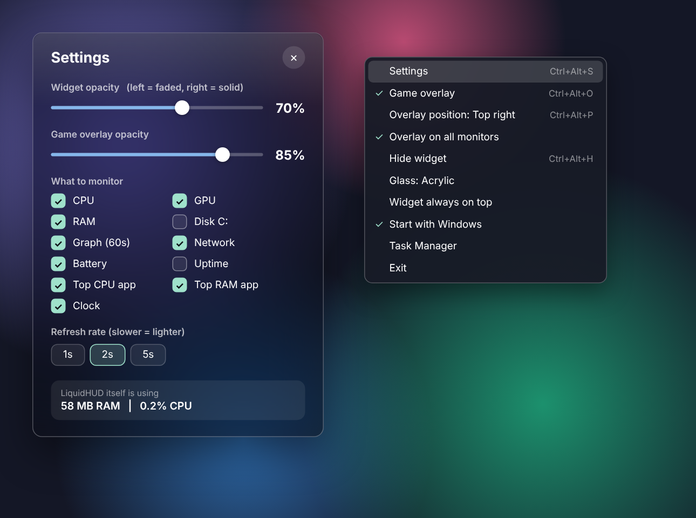
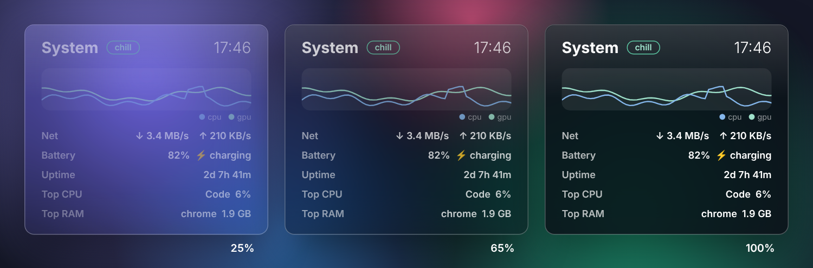
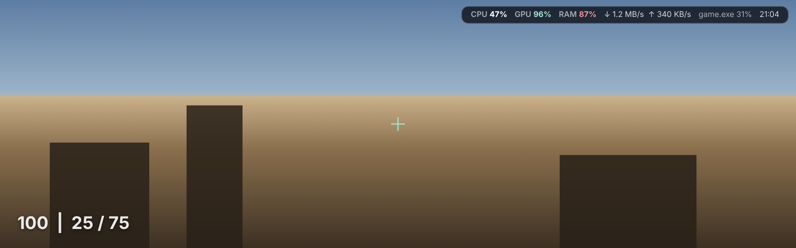

# LiquidHUD

**A glass-style system monitor widget and game overlay for Windows, built from scratch with nothing but PowerShell and WPF.**
No Rainmeter, no HWiNFO, no installer, no admin rights. One `.ps1` file.


> Images in this README are rendered previews of the UI. Your glass will blur whatever wallpaper you have.

---

## Features

| | |
|---|---|
| **Live stats** | CPU, GPU, RAM, disk C:, network up/down, battery, uptime, top CPU app, top RAM app, clock |
| **60-second graph** | CPU and GPU history |
| **Real glass** | Windows 11 Acrylic or Mica blur drawn by the OS, with rounded corners and a native shadow |
| **Game overlay** | Thin click-through bar that stays on top of every app, on every monitor |
| **Global hotkeys** | Work while you're in a game |
| **Opacity sliders** | One for the widget, one for the overlay |
| **Pick your metrics** | Tick what you want to see. Unticked metrics aren't collected at all |
| **Lightweight** | Runs at BelowNormal priority with a 2 s refresh and periodic memory trim |
| **Status pill** | Shows `chill` below 40 % CPU, `busy` from 40–85 %, and `hot!` above 85 % (numbers also turn red) |

<p align="center"></p>

---

## Requirements

- **Windows 10 or 11.** Windows 11 22H2 or newer gets the real blur. Older versions get a dark glass look without blur.
- **Windows PowerShell 5.1.** It's already built into Windows, so you don't need to install anything.

---

## Install (step by step)

### Step 1: Download

Pick **one**:

- **Easiest:** click the green **Code** button at the top of this page, then **Download ZIP**.
- **With git:**
  ```powershell
  git clone https://github.com/NikoAgera/LiquidHUD.git
  ```

### Step 2: Unzip

Right-click the ZIP, choose **Extract All…**, and pick a permanent spot, for example:

```
C:\Users\<you>\Documents\LiquidHUD
```

> Don't run it from inside the ZIP or from the Downloads folder if you plan to use *Start with Windows*. The startup shortcut points at the file's location.

### Step 3: Unblock the files (one time)

Windows marks downloaded files as "from the internet". To clear that mark, open PowerShell in the folder and run:

```powershell
Get-ChildItem -Recurse | Unblock-File
```

Or right-click `LiquidHUD.ps1`, choose **Properties**, tick **Unblock**, then click **OK**.

### Step 4: Run it

Double-click **`Start-LiquidHUD.bat`**.

The widget appears in the top-right of your screen. The `.bat` launches PowerShell hidden, with `-ExecutionPolicy Bypass` for this one script only, so your system's execution policy isn't changed.

<details>
<summary>Prefer to run it manually?</summary>

```powershell
powershell -NoProfile -STA -ExecutionPolicy Bypass -File .\LiquidHUD.ps1
```
</details>

### Step 5: Make it yours

- **Drag** the widget anywhere. Its position is remembered.
- **Right-click** the widget and choose **Settings**, or press `Ctrl+Alt+S`.
- **Right-click** the widget and choose **Start with Windows** if you want it on every boot.

---

## Settings



| Setting | What it does |
|---|---|
| **Widget opacity** | Slide left to fade the widget, slide right to make it solid |
| **Game overlay opacity** | Same, for the overlay bar (20–100 %) |
| **What to monitor** | Tick a metric to show and collect it. Untick it to hide it and stop collecting it |
| **Refresh rate** | 1 s, 2 s or 5 s. Slower uses less CPU |
| **LiquidHUD itself is using** | Live RAM and CPU used by the widget itself |



Settings are saved to `%APPDATA%\LiquidHUD\settings.json`.

---

## Game overlay



1. Press **`Ctrl+Alt+O`** to turn the overlay on.
2. Press **`Ctrl+Alt+P`** to move it. It cycles through top left, top center, top right, bottom left and bottom right.
3. Press **`Ctrl+Alt+H`** to hide the big widget so only the overlay stays.

The overlay is **click-through**: your mouse goes straight to the game, and it never steals focus or shows up in Alt+Tab.

> **Important:** set your game's display mode to **Borderless** or **Windowed Fullscreen**. In **Exclusive Fullscreen** the game takes over the whole display and no overlay can draw on top. That's a Windows limit, not a bug in LiquidHUD.

**Anti-cheat:** LiquidHUD is a plain top-most window. It doesn't inject into, hook or read from any game process. It only reads the same public Windows counters that Task Manager uses.

---

## Hotkeys

| Keys | Action |
|---|---|
| `Ctrl+Alt+S` | Open Settings |
| `Ctrl+Alt+O` | Toggle game overlay |
| `Ctrl+Alt+P` | Cycle overlay position |
| `Ctrl+Alt+H` | Hide / show widget |
| Double-click widget | Open Task Manager |
| Right-click widget | Menu |

---

## How it works

```
+------------------------------+       synchronized        +-------------------------+
|  Background runspace         |        hashtable          |  UI thread (WPF)        |
|  BelowNormal priority        |  ---------------------->  |  DispatcherTimer        |
|                              |                           |                         |
|  PerformanceCounter (CPU,GPU)|                           |  Widget window          |
|  ComputerInfo (RAM)          |                           |   (DWM Acrylic/Mica)    |
|  DriveInfo (disk)            |                           |  Overlay window(s)      |
|  NetworkInterface (net)      |                           |   (layered, click-thru) |
|  PowerStatus (battery)       |                           |  Settings window        |
|  Process list (top apps)     |                           |                         |
+------------------------------+                           +-------------------------+
```

- **Glass:** `DwmSetWindowAttribute` with `DWMWA_SYSTEMBACKDROP_TYPE` (Acrylic = 3, Mica = 2), rounded corners and dark mode. The window isn't a layered window, so dragging stays smooth.
- **Overlay:** a layered window with the extended styles `WS_EX_TRANSPARENT | WS_EX_TOOLWINDOW | WS_EX_NOACTIVATE`. LiquidHUD calls `SetWindowPos(HWND_TOPMOST)` every tick so the overlay stays on top.
- **Hotkeys:** `RegisterHotKey` on a hidden message window.
- **Low cost:**
  - The data collection runs on its own thread at BelowNormal priority.
  - GPU counters are created only when GPU is ticked, and refreshed every 30 s.
  - The process scan for top apps runs every 5 s, and only when one of those metrics is ticked.
  - Text only re-renders when it changes, and bars only animate when their value changes.
  - The working set is trimmed every 60 s.

### Expected resource use

These are estimates. Open **Settings** to see the live numbers on your machine.


| | |
|---|---|
| CPU | ~0.1–0.5 % at a 2 s refresh |
| RAM | ~50–80 MB. This is mostly the PowerShell and WPF runtime itself, so it's the practical floor for a script-based app |

---

## Troubleshooting

| Problem | Fix |
|---|---|
| **Nothing happens** when I double-click the `.bat` | Run Step 3 (Unblock). Then try the manual command from Step 4 in a PowerShell window so you can see any error |
| **I want to quit, but the widget is hidden** | Press `Ctrl+Alt+H` to show it, then right-click and choose **Exit**. Or open Task Manager and end **Windows PowerShell** |
| **No blur, just dark glass** | You're on Windows 10 or Windows 11 older than 22H2. Also check **Settings → Personalization → Colors → Transparency effects** is **On** |
| **GPU shows `n/a`** | Your GPU driver doesn't expose the `GPU Engine` counters. Update your graphics driver |
| **Overlay not visible in a game** | Switch the game to Borderless or Windowed Fullscreen |
| **The overlay is in the wrong spot on a second monitor** | Mixed DPI scaling across monitors can offset it. Untick **Overlay on all monitors** to keep it on the main screen |
| **I want to reset everything** | Delete `%APPDATA%\LiquidHUD\settings.json` |

---

## Uninstall

1. Right-click the widget and choose **Exit**.
2. If you turned on **Start with Windows**, delete `LiquidHUD.lnk` from `shell:startup` (press `Win+R`, type `shell:startup`, press Enter).
3. Delete the LiquidHUD folder and `%APPDATA%\LiquidHUD`.

---

## Not included (yet)

- **CPU/GPU temperature.** Windows doesn't expose it without a kernel driver or admin rights.
- **Game FPS.** Measuring FPS needs hooking into the game, which this project deliberately avoids.

---

## License

[MIT](LICENSE). Do whatever you like with it.
